<!-- ╔══════════════════════════════════════════════════════╗ -->
<!--                    CYBERPUNK BANNER                   -->
<!-- ╚══════════════════════════════════════════════════════╝ -->

<p align="center">
  
</p>

<!-- TERMINAL -->
<p align="center">
  
</p>

<p align="center"> <a href="https://www.linkedin.com/in/ihatefw">  </a> <a href="https://github.com/IHATEFW">  </a> </p>

---

# ☠️ SOBRE MÍ

```bash
┌──(ihatefw㉿kali)-[~]
└─$ whoami

🌱 Ingeniero en Ciberseguridad

Llevo unos 7 años interesado por el hacking,
resolviendo múltiples máquinas de plataformas
como HackTheBox, TryHackMe y DockerLabs.

Estoy aquí para ofrecerte los conocimientos
básicos para empezar en esto, paso a paso.

Por ende, he creado varios writeups de cómo
resolver las máquinas más sencillas que podrás
encontrar, y así lograr tus primeros hackeos ✨
```

---

# 🎖️ INSIGNIAS Y CREDENCIALES DIGITALES

<p align="center"> <a href="https://www.linkedin.com/in/ihatefw/details/certifications/"></a></p>

### 🗡️ Hacking & Linux

<table align="center">
  <tr>
    <td align="center" valign="top" width="25%">
      <a href="https://www.linkedin.com/in/ihatefw/details/certifications/">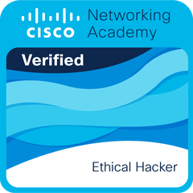</a><br/>
      <b>Ethical Hacker</b><br/>
      <sub>Cisco Networking Academy · feb. 2026</sub>
    </td>
    <td align="center" valign="top" width="25%">
      <a href="https://www.linkedin.com/in/ihatefw/details/certifications/"></a><br/>
      <b>Introducción al Hacking</b><br/>
      <sub>Hack4u · feb. 2026<br/><code>1396-9093-2790-5389</code></sub>
    </td>
    <td align="center" valign="top" width="25%">
      <a href="https://www.linkedin.com/in/ihatefw/details/certifications/">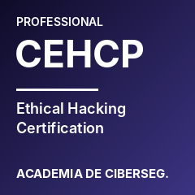</a><br/>
      <b>Ethical Hacking Professional (CEHCP)</b><br/>
      <sub>Academia de Ciberseguridad · ago. 2024<br/><code>9EI5xKFFqT</code></sub>
    </td>
    <td align="center" valign="top" width="25%">
      <a href="https://www.linkedin.com/in/ihatefw/details/certifications/"></a><br/>
      <b>Introducción a Linux</b><br/>
      <sub>Hack4u · nov. 2025<br/><code>2223-2976-9425-2922</code></sub>
    </td>
  </tr>
  <tr>
    <td align="center" valign="top" width="25%">
      <a href="https://www.linkedin.com/in/ihatefw/details/certifications/"></a><br/>
      <b>Personalización de Linux</b><br/>
      <sub>Hack4u · dic. 2025<br/><code>6197-6744-1004-3276</code></sub>
    </td>
  </tr>
</table>

### 🛡️ Fortinet

<table align="center">
  <tr>
    <td align="center" valign="top" width="25%">
      <a href="https://www.linkedin.com/in/ihatefw/details/certifications/">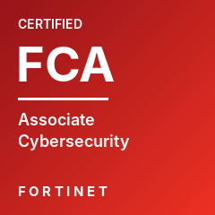</a><br/>
      <b>Certified Associate Cybersecurity</b><br/>
      <sub>Fortinet · nov. 2024 – nov. 2026<br/><code>6611489297BM</code></sub>
    </td>
    <td align="center" valign="top" width="25%">
      <a href="https://www.linkedin.com/in/ihatefw/details/certifications/">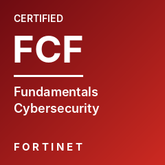</a><br/>
      <b>Certified Fundamentals Cybersecurity</b><br/>
      <sub>Fortinet · nov. 2024 – nov. 2026<br/><code>2688550746BM</code></sub>
    </td>
    <td align="center" valign="top" width="25%">
      <a href="https://www.linkedin.com/in/ihatefw/details/certifications/">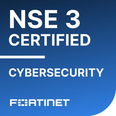</a><br/>
      <b>NSE 3</b><br/>
      <sub>Fortinet · nov. 2024 – nov. 2026<br/><code>0d4f2716-786f-4f8c-bbb5-7cccc52706f2</code></sub>
    </td>
    <td align="center" valign="top" width="25%">
      <a href="https://www.linkedin.com/in/ihatefw/details/certifications/">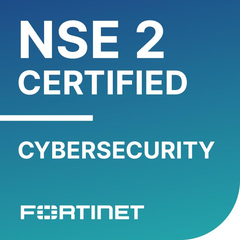</a><br/>
      <b>NSE 2</b><br/>
      <sub>Fortinet · nov. 2024 – nov. 2026<br/><code>cf38329d-e8e7-4cf4-b825-01dfb631cdeb</code></sub>
    </td>
  </tr>
  <tr>
    <td align="center" valign="top" width="25%">
      <a href="https://www.linkedin.com/in/ihatefw/details/certifications/">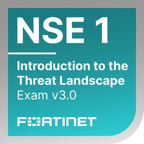</a><br/>
      <b>NSE 1</b><br/>
      <sub>Fortinet · nov. 2024 – nov. 2026<br/><code>d66393db-612c-440e-b862-d6d78feb3c39</code></sub>
    </td>
  </tr>
</table>

### 📋 Fundamentos, Auditoría & ISO 27001

<table align="center">
  <tr>
    <td align="center" valign="top" width="25%">
      <a href="https://www.linkedin.com/in/ihatefw/details/certifications/">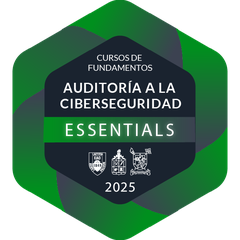</a><br/>
      <b>Fundamentos de Auditoría a la Ciberseguridad</b><br/>
      <sub>Diplomados en Ciberseguridad · mar. 2025</sub>
    </td>
    <td align="center" valign="top" width="25%">
      <a href="https://www.linkedin.com/in/ihatefw/details/certifications/">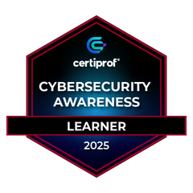</a><br/>
      <b>Cybersecurity Awareness Learner</b><br/>
      <sub>CertiProf · dic. 2024</sub>
    </td>
    <td align="center" valign="top" width="25%">
      <a href="https://www.linkedin.com/in/ihatefw/details/certifications/"></a><br/>
      <b>Seguridad de la Información C&DC 2024</b><br/>
      <sub>SONDA · jun. 2024 – jun. 2025</sub>
    </td>
    <td align="center" valign="top" width="25%">
      <a href="https://www.linkedin.com/in/ihatefw/details/certifications/">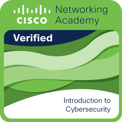</a><br/>
      <b>Introduction to Cybersecurity</b><br/>
      <sub>Cisco Networking Academy · dic. 2023</sub>
    </td>
  </tr>
</table>

### ⚙️ Gestión & Metodologías Ágiles

<table align="center">
  <tr>
    <td align="center" valign="top" width="25%">
      <a href="https://www.linkedin.com/in/ihatefw/details/certifications/">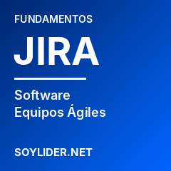</a><br/>
      <b>Fundamentos Teóricos en Jira Software</b><br/>
      <sub>soylider.net · may. 2024<br/><code>A3GI3I-CE000216</code></sub>
    </td>
    <td align="center" valign="top" width="25%">
      <a href="https://www.linkedin.com/in/ihatefw/details/certifications/">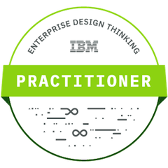</a><br/>
      <b>Enterprise Design Thinking Practitioner</b><br/>
      <sub>IBM · ago. 2021</sub>
    </td>
    <td align="center" valign="top" width="25%">
      <a href="https://www.linkedin.com/in/ihatefw/details/certifications/"></a><br/>
      <b>Scrum Fundamentals Certified</b><br/>
      <sub>VMEdu · ago. 2021<br/><code>868285</code></sub>
    </td>
  </tr>
</table>

<p align="center"><sub>☠️ Credenciales verificables en mi perfil de <a href="https://www.linkedin.com/in/ihatefw/details/certifications/">LinkedIn</a></sub></p>
